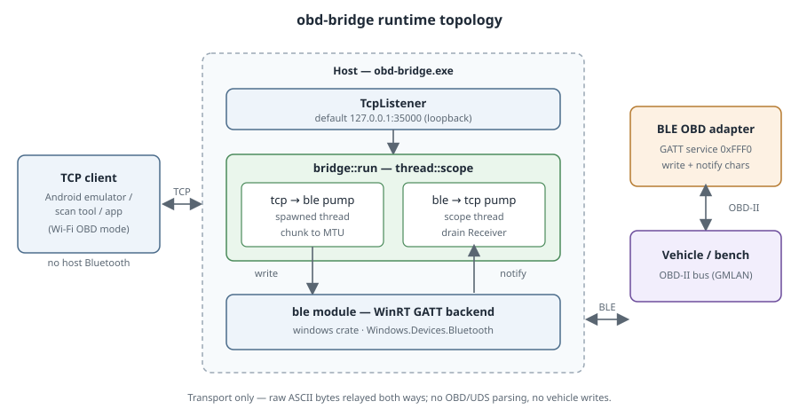
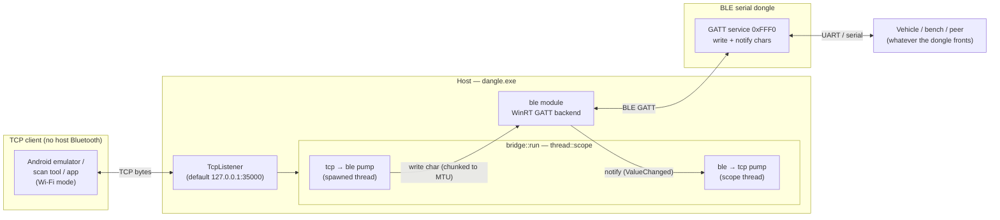
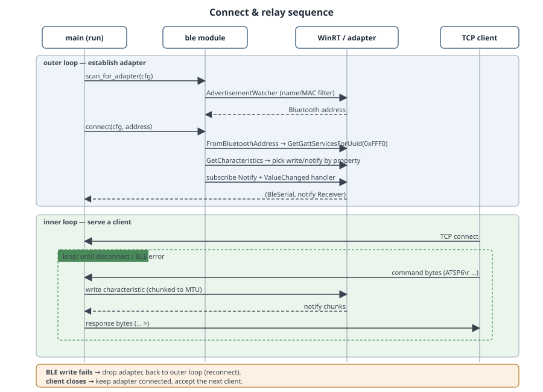
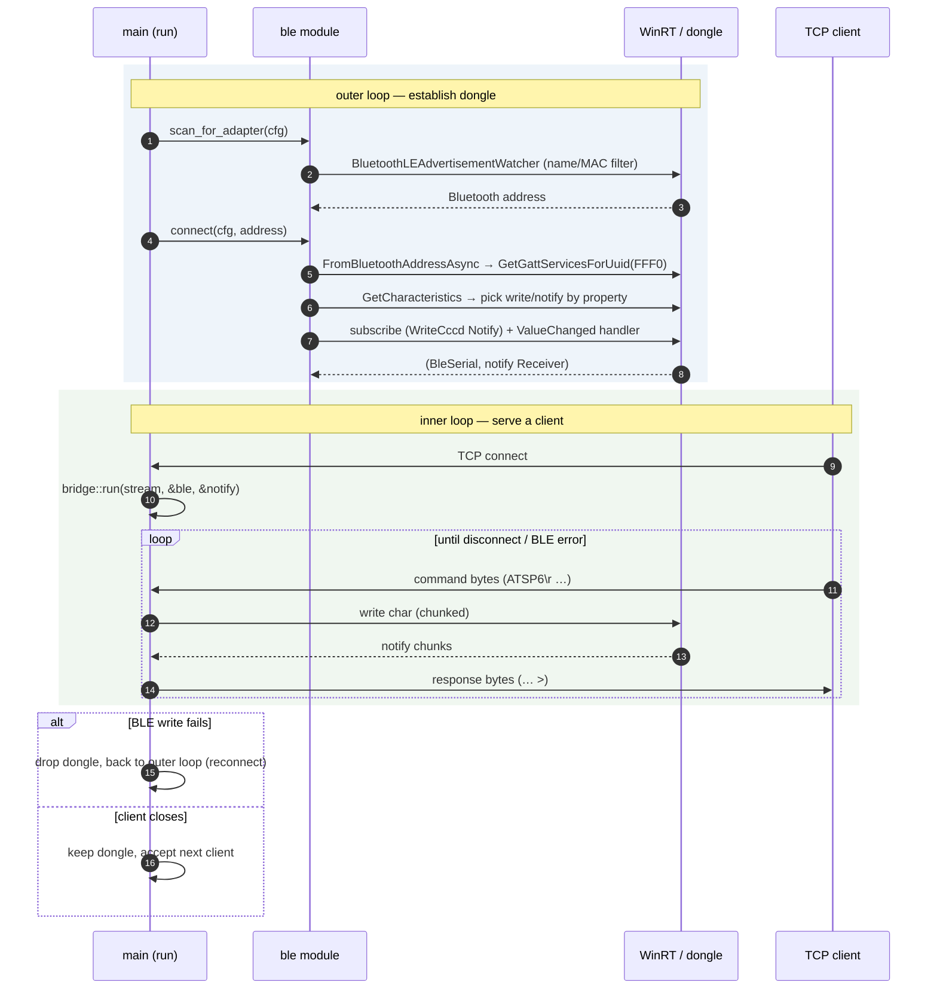
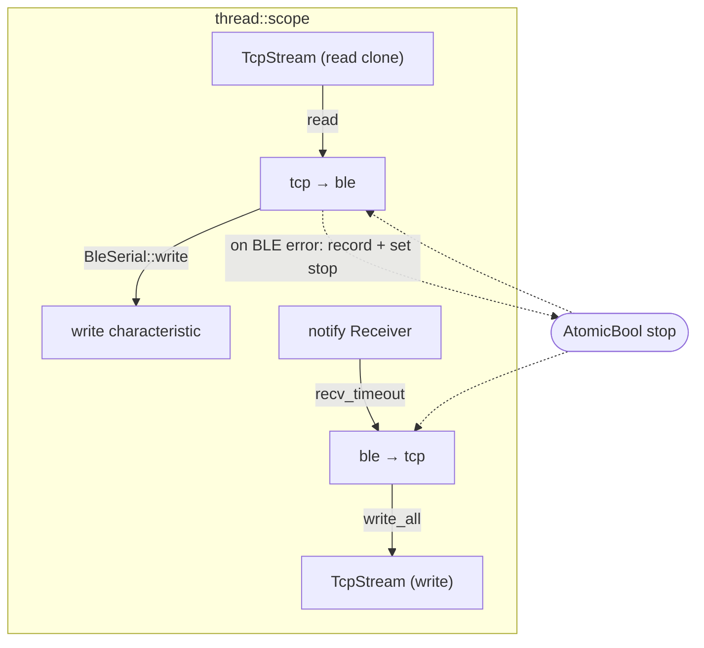
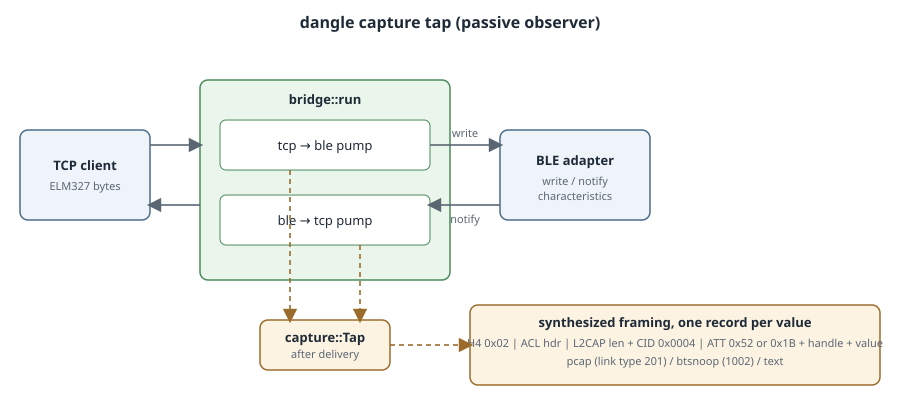
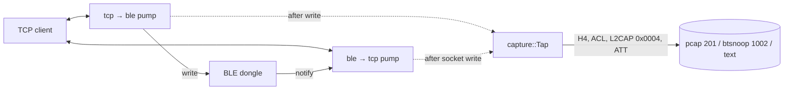
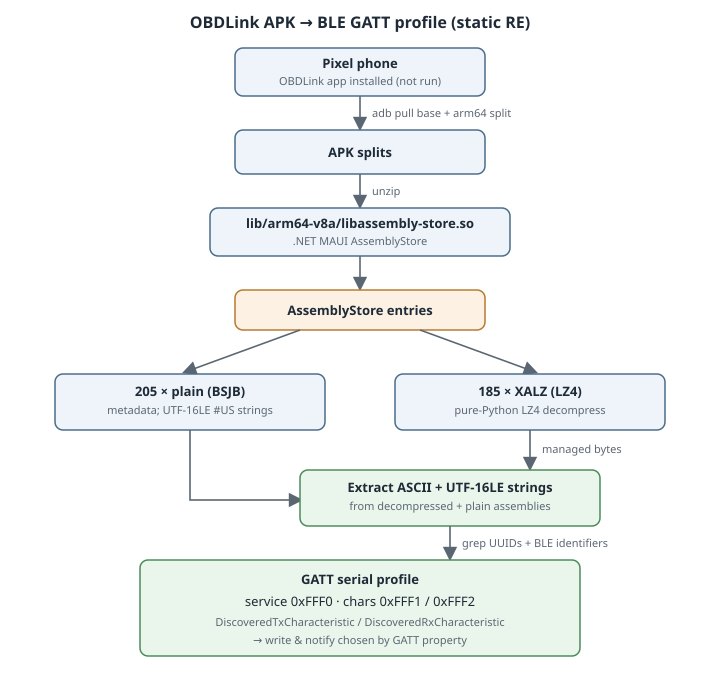
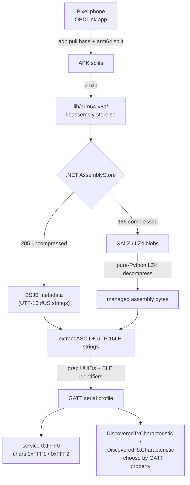

# Architecture

This document describes how `dangle` works and how its default Bluetooth LE serial profile was
chosen. Each diagram is given twice: an inline **Mermaid** block (GitHub renders it) and a
standalone **SVG** under [`diagrams/`](diagrams/) for viewers that prefer an image.

Companion docs: [`layout.md`](layout.md) (crate/module layout, dependencies) and
[`ble-re.md`](ble-re.md) (the reverse-engineering write-up behind the default GATT table).

---

## 1. What the bridge does

A Bluetooth LE serial dongle exposes its serial stream over a GATT service. Tools that can open a
TCP socket but cannot use the host's Bluetooth radio — most importantly an Android emulator — cannot
talk to such a dongle directly. `dangle` sits in the middle: it owns the BLE connection on the host
and re-exposes the dongle's serial stream as a **TCP** server, so the dongle looks like a Wi-Fi
serial device. The motivating dongle is an OBD adapter (e.g. an OBDLink MX), where the result looks
like a Wi-Fi OBD dongle, but the bridge is protocol-agnostic.

The bridge binds the host address (loopback `127.0.0.1:35000` by default). Inside the standard
Android emulator that IPv4 loopback is named `10.0.2.2`, so the app's Wi-Fi host is `10.0.2.2` and
the port is the bound port. `10.0.2.2` is rejected as a `--listen` address. When the emulator
cannot open it, `adb -s emulator-<digits> reverse tcp:<port> tcp:<port>` makes the emulator's
`127.0.0.1:<port>` reach the host socket, and the app uses host `127.0.0.1`.

It is a **transport bridge only**. It relays raw bytes and parses nothing on the wire; it issues no
writes of its own. Any protocol — an ELM327/OBD session being the obvious example, with `AT` command
lines terminated by `\r` and responses ending at the `>` prompt — is the client's responsibility.

### Runtime topology

The relay is symmetric and byte-exact: bytes from the socket are written to the dongle's write
characteristic (split into MTU-sized GATT writes); bytes the dongle sends via GATT notifications are
written straight back to the socket.

---

## 2. Connection and relay sequence

The bridge runs two nested loops: an outer loop that (re)connects the dongle, and an inner loop that
serves one TCP client at a time while the dongle stays connected. A BLE write failure breaks back to
the outer loop to reconnect; a client disconnect keeps the dongle and waits for the next client.

### Why two threads

A blocking socket read and a blocking notification receive cannot share one thread, so the pipe runs
inside a [`std::thread::scope`]: the TCP→BLE direction is a spawned thread, the BLE→TCP direction runs
on the scope's own thread, and both borrow the same `&BleSerial`. A shared `AtomicBool` stop flag and
a 200 ms poll timeout on each side let either direction notice a shutdown promptly without
busy-waiting. The notification `Receiver` is deliberately kept out of `BleSerial` so the struct stays
`Sync` and can be borrowed across the two threads.

### Capture tap

An optional `capture::Tap` observes both directions after delivery and records each value as a
pcap/btsnoop record with synthesized HCI ACL / L2CAP / ATT framing (see [`capture.md`](capture.md)).

---

## 3. How the default BLE profile was chosen

The default GATT UUIDs are not guessed — they were read statically out of the **OBDLink** companion
app (a .NET MAUI application), used here as a worked example of a BLE serial dongle. No app was
installed or run; the APK was treated as data. Full detail, including the recovered UUID table, is in
[`ble-re.md`](ble-re.md); the pipeline is summarised here. Other dongles differ, which is why
`--service` / `--write` / `--notify` exist.

### GATT profile (result)

| Role           | 16-bit | Full UUID                              |
| -------------- | ------ | -------------------------------------- |
| Serial service | 0xFFF0 | `0000fff0-0000-1000-8000-00805f9b34fb` |
| Characteristic | 0xFFF1 | `0000fff1-0000-1000-8000-00805f9b34fb` |
| Characteristic | 0xFFF2 | `0000fff2-0000-1000-8000-00805f9b34fb` |

The app discovers which characteristic is write and which is notify **by property** (it holds
`DiscoveredTxCharacteristic`/`DiscoveredRxCharacteristic`), so the bridge does the same: the
**notify/indicate** characteristic is the dongle→host path, the **write/write-without-response**
characteristic is the host→dongle path. `--service`/`--write`/`--notify` override this for dongles
that differ (e.g. Nordic-UART clones).

---

## 4. Module map

| File         | Responsibility                                                                        |
| ------------ | ------------------------------------------------------------------------------------- |
| `main.rs`    | argument handling; outer BLE reconnect loop; inner TCP accept loop                    |
| `config.rs`  | args + env parsing, UUID/address parsing, unit tests (platform-independent)           |
| `ble.rs`     | WinRT backend: scan, connect, service/characteristic discovery, subscribe, write      |
| `bridge.rs`  | the byte pipe: two relay directions inside a `thread::scope`                          |
| `capture.rs` | optional capture tap: pcap/btsnoop/text writers with synthesized ATT framing          |

See [`layout.md`](layout.md) for the dependency rationale and the enabled `windows`-crate features.

[`std::thread::scope`]: https://doc.rust-lang.org/std/thread/fn.scope.html
